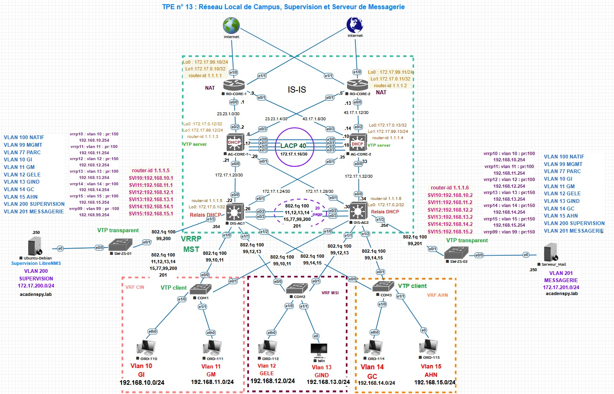

cat << 'EOF' > README.md
# 🏛️ Architecture Réseau de Campus, Supervision & Messagerie


Conception, implémentation et validation d'une infrastructure réseau hiérarchique complète pour le campus **ACDENSPY** (`acadenspy.lab`) sous **EVE-NG**, intégrant la haute disponibilité L2/L3, l'isolation multi-départements par **VRF**, la supervision centralisée via **LibreNMS** et une plateforme de messagerie interne **iRedMail**.

---

## 🗺️ Topologie du Réseau



---

## 🏗️ Architecture Hiérarchique & Technologies

L'infrastructure est structurée en **5 couches fonctionnelles** :

* **Couche Cœur (`RO-CORE-1`, `RO-CORE-2`) :** Routage **IS-IS Level-2**, redondance WAN et traduction d'adresses **NAT/PAT** vers Internet.
* **Couche Agrégation (`AG-CORE-1`, `AG-CORE-2`) :** Agrégation de liens **LACP (`Port-channel 40`)**, serveur **VTP** centralisé et pools **DHCP** multi-VLANs.
* **Couche Distribution (`DIS-AG1`, `DIS-AG2`) :** Passerelles redondantes **VRRP** avec répartition de charge par département, **Relais DHCP**, **EtherChannel PAgP (`Port-channel 20`)**, **MSTP** (2 instances) et isolation logique par **VRF** (`CIN`, `MSI`, `AHN`).
* **Couche Accès (`COM1`, `COM2`, `COM3`) :** Commutateurs clients VTP, **PortFast**, **BPDU Guard** et contrôle d'accès physique par **Port-Security** (`sticky`, mode `restrict`).
* **Zone Serveurs (`SW-ZS-01`, `SW-ZS-02`) :** Commutateurs en mode **VTP Transparent** hébergeant les services d'infrastructure isolés :
  * **Supervision (`172.17.200.250`) :** Serveur **LibreNMS** interrogeant les 11 équipements Cisco via **SNMPv2c** sécurisé par ACL sur le VLAN d'administration (`VLAN 99`).
  * **Messagerie (`172.17.201.250`) :** Serveur **iRedMail** avec webmail **Roundcube** et console **iRedAdmin** pour le domaine `acadenspy.lab`.

---

## 📊 Plan des VLANs & Segmentation VRF

| VLAN | Nom | Sous-réseau | Passerelle Virtuelle (VRRP) | VRF Associée |
| :---: | :--- | :--- | :--- | :---: |
| **10** | `GI` (Génie Informatique) | `192.168.10.0/24` | `192.168.10.254` (Master `DIS-AG1`) | `CIN` |
| **11** | `GM` (Génie Mécanique) | `192.168.11.0/24` | `192.168.11.254` (Master `DIS-AG1`) | `CIN` |
| **12** | `GELE` (Génie Électrique) | `192.168.12.0/24` | `192.168.12.254` (Master `DIS-AG1`) | `MSI` |
| **13** | `GIND` (Génie Industriel) | `192.168.13.0/24` | `192.168.13.254` (Master `DIS-AG2`) | `MSI` |
| **14** | `GC` (Génie Civil) | `192.168.14.0/24` | `192.168.14.254` (Master `DIS-AG2`) | `AHN` |
| **15** | `AHN` (Arts & Humanités Num.) | `192.168.15.0/24` | `192.168.15.254` (Master `DIS-AG2`) | `AHN` |
| **77** | `PARC` | — | — | Ports désactivés |
| **99** | `MGMT` (Administration) | `192.168.99.0/24` | `192.168.99.254` (Master `DIS-AG2`) | Global |
| **100** | `NATIF` | — | — | Trunks 802.1Q |
| **200** | `SUPERVISION` | `172.17.200.0/24` | `172.17.200.254` (`DIS-AG1`) | Global |
| **201** | `MESSAGERIE` | `172.17.201.0/24` | `172.17.201.254` (`DIS-AG2`) | Global |

---

## 📂 Structure du Dépôt

```text
13_Campus/
├── TPE_13.unl                    # Projet complet EVE-NG
├── topologie.jpeg                # Schéma global de l'architecture
├── Rapport_TPE13_Boum_Mewa.pdf   # Rapport technique & validations
├── README.md                     # Documentation du projet
└── configs/                      # Configurations IOS (11 équipements)
    ├── RO-CORE/                  # RO-CORE-1.ios, RO-CORE-2.ios
    ├── AG-CORE/                  # AG-CORE-1.ios, AG-CORE-2.ios
    ├── DIS-AG/                   # DIS-AG1.ios, DIS-AG2.ios
    ├── access/                   # access1.ios, access2.ios, access3.ios
    └── SW-ZS/                    # SW-ZS-01.ios, SW-ZS-02.ios
